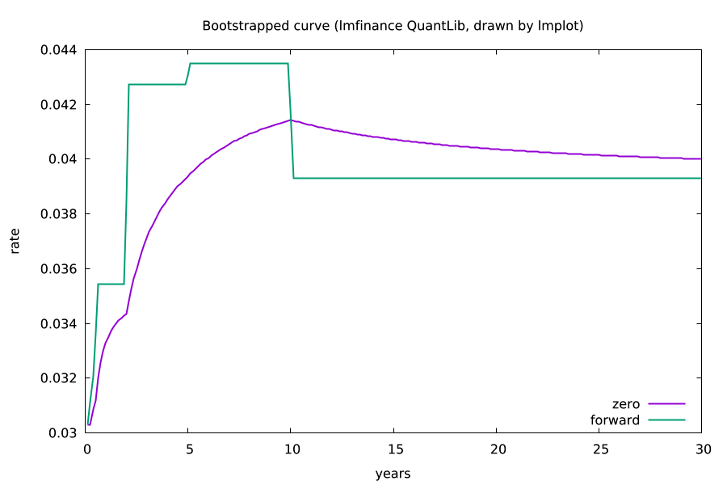

# lmfinance

**Quantitative finance for lmscript in one static executable: QuantLib yield curves, bonds, swaps,
vanilla options priced four ways, Greeks, risk measures and calibration.** It is a scripting host,
not a command-line tool: write an [lmscript](https://lmctl.com/tools/lmscript/skill.html) `_dsl_`
block, compile it, run it with `lmfinance --dsl`. No Python, no Boost libraries, no shared libraries.

[](https://github.com/lmctl-ai/lmfinance/actions/workflows/ci.yml)
[](LICENSE)

```
# bs.lms: Black-Scholes call S=100 K=100 r=5% vol=20% T=1 is worth 10.4506
p = _dsl_ cli="lmfinance" install="github:lmctl-ai/lmfinance@latest";
let m = model.black_scholes(100.0, 0.05, 0.0, 0.2);
let call = instrument.european_call(100.0, 1.0);
let r = pricing.price(call, m, pricing.analytic());
lmf.print("price " + str(r.price()) + " delta " + str(r.delta()));
lmf.assert_close(r.price(), 10.4506, 0.00005);
end _dsl_
savedsl(p, "bs.dslb");
system ${dsl_cli(p)} --dsl bs.dslb;
```

`lmscript bs.lms` finds `lmfinance` on `PATH` or downloads the release binary for your platform on
first use, compiles against the schema built into it, and runs the program.

## What it does

Six namespaces, each a context object of the schema; objects are built by chained methods
(the DSL has no lists or closures). Rates are decimals (`0.05`), maturities are years, dates are
`YYYY-MM-DD` strings. The evaluation date defaults to 2024-01-02 (never the system clock) and is set
with `market.set_date`.

| namespace | functions |
| --- | --- |
| `market` | `set_date` `date` `flat_curve(r)` `zero_curve()` `bootstrap_curve()` → `CurveBuilder` `.zero(years, rate)` `.deposit("3M", rate)` `.swap("5Y", rate)` `.build()` → `Curve` `.discount .zero .forward .bumped .save_csv` |
| `instrument` | `european_call/put(K, T)` `american_call/put(K, T)` → `Option`; `bond(face, coupon, years, freq)` `zero_bond(face, years)` → `Bond`; `swap(notional, fixed_rate, years)` → `Swap` `.receiver .payer .spread` |
| `model` | `black_scholes(S, r, q, vol)` `heston(S, r, q, v0, kappa, theta, sigma, rho)` → `Model` `.param .with_spot .with_rate .with_vol` |
| `pricing` | engines `analytic()` `binomial(n)` `binomial_tree("crr"\|"jr"\|"tian"\|"lr", n)` `finite_diff(tsteps, grid)` `monte_carlo(paths, seed)` `baw()`; `price(option, model, engine)` → `Result` `.price .stderr .delta .gamma .vega .theta .rho`; bonds: `bond_clean_price bond_npv bond_accrued bond_price_from_yield bond_yield bond_duration bond_macaulay_duration bond_convexity`; swaps: `swap_npv swap_par_rate swap_annuity` |
| `risk` | bumped `delta gamma vega rho theta` for any engine; `bond_dv01` `swap_dv01`; `var_normal` `es_normal`; `save_profile` (price, delta, gamma over a spot range, CSV) |
| `calibration` | `implied_vol(option, model, engine, price)`; `heston(S, r, q)` → `HestonFit` `.quote(K, T, vol)` `.guess(...)` `.fit()` → `Model` `.error()` |
| `lmf` | `assert_close` `check` `print` `save_text` `version` |

Conventions and details: [durable-memory/03-schema-v0.md](durable-memory/03-schema-v0.md).

Combine it with other hosts in one script: [examples/combo/](examples/combo) bootstraps a curve and
profiles an option with lmfinance and draws them with [lmplot](https://github.com/lmctl-ai/lmplot)
(two `_dsl_` blocks, two hosts).



## Examples

| Program | Shows |
| --- | --- |
| [option_pricing.lms](examples/option_pricing.lms) | one call and one American put through every engine, binomial error against the closed form |
| [bond_curve.lms](examples/bond_curve.lms) | curve bootstrapped from deposits and swaps reprices its inputs; bond price, yield, duration, DV01 |
| [greeks.lms](examples/greeks.lms) | analytic, tree and Monte Carlo Greeks agree |
| [heston_smile.lms](examples/heston_smile.lms) | a Heston smile and a calibration that recovers its five parameters |
| [portfolio_risk.lms](examples/portfolio_risk.lms) | DV01s, normal VaR and expected shortfall of a small book |
| [combo/yield_curve.lms](examples/combo/yield_curve.lms), [combo/option_greeks.lms](examples/combo/option_greeks.lms) | lmfinance computes, lmplot draws |

`tests/` holds the checks against textbook values (Black-Scholes 10.4506 and 5.5735, Hull's
example, the American put 6.0903, bond annuity formulas, put-call parity, Heston → Black-Scholes
limit, bootstrap round trips).

## Build

C++17 compiler, CMake 3.24, git, curl; nothing else.

```sh
scripts/sync-deps.sh            # QuantLib at the commit and Boost headers at the sha256 in deps.lock
cmake -S . -B build && cmake --build build     # Release, -O1 for QuantLib, about 3.5 minutes on 4 cores
./test.sh                       # needs lmscript on PATH
```

Linux builds are fully static; macOS links only system libraries; Windows links the MinGW runtime
statically. `lmfinance --notices` prints the license texts of everything inside.

## License

MIT ([LICENSE](LICENSE)). QuantLib is a modified BSD license and Boost (headers only) is BSL-1.0;
see [THIRD_PARTY_NOTICES](THIRD_PARTY_NOTICES).
