# lmfinance

**QuantLib for lmscript: yield curves, bonds, swaps, options, Greeks, risk and calibration in one static executable.**

[](https://github.com/lmctl-ai/lmfinance/actions/workflows/ci.yml)
[](https://github.com/lmctl-ai/lmfinance/releases)
[](LICENSE)

### Options

| 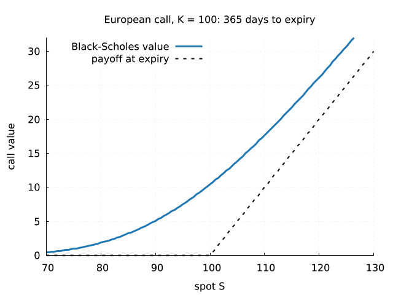 | 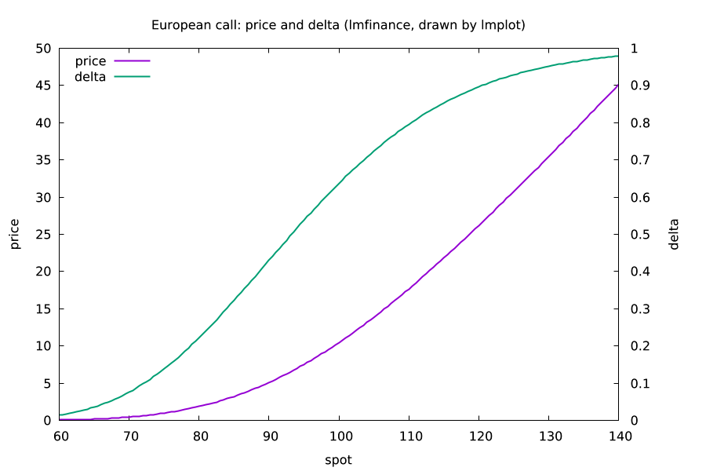 |
| --- | --- |
| A call melting onto its payoff as expiry nears (needs ffmpeg).<br>`lmctl autorun https://raw.githubusercontent.com/lmctl-ai/lmfinance/main/examples/gallery/option_decay.lms` | Call price and delta against the spot.<br>`lmctl autorun https://raw.githubusercontent.com/lmctl-ai/lmfinance/main/examples/gallery/option_greeks.lms` |

| 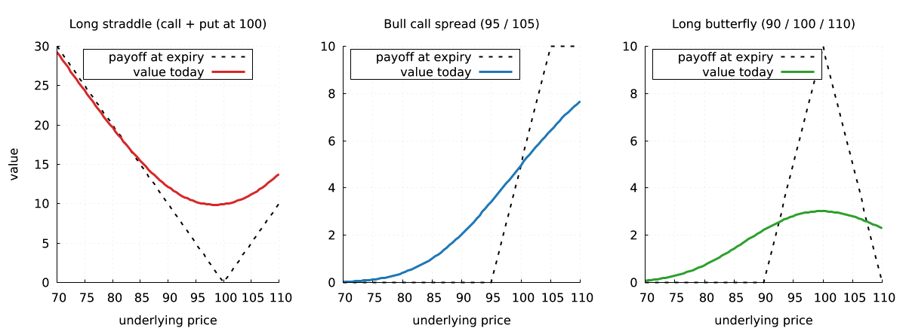 | 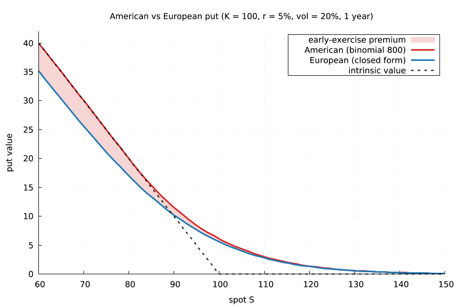 |
| --- | --- |
| Straddle, bull spread, butterfly: value today against the payoff.<br>`lmctl autorun https://raw.githubusercontent.com/lmctl-ai/lmfinance/main/examples/gallery/option_strategies.lms` | American against European put: the early-exercise premium.<br>`lmctl autorun https://raw.githubusercontent.com/lmctl-ai/lmfinance/main/examples/gallery/american_put.lms` |

| 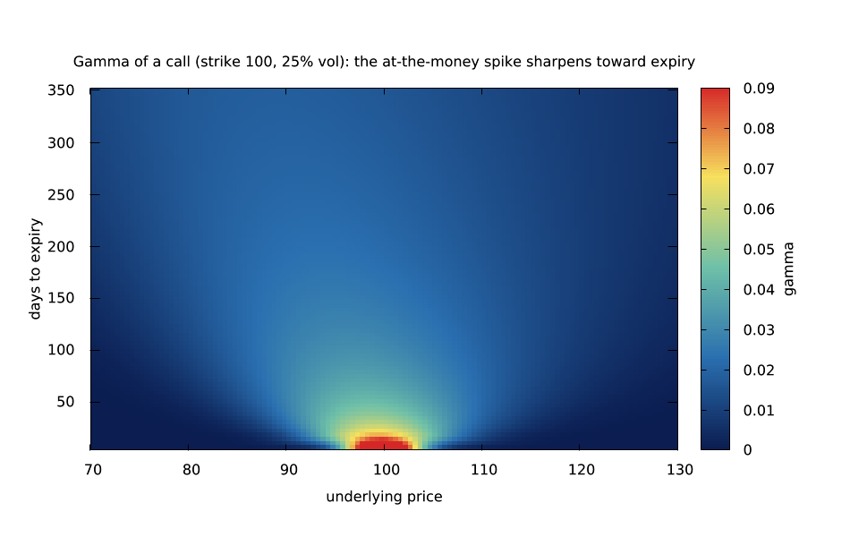 | 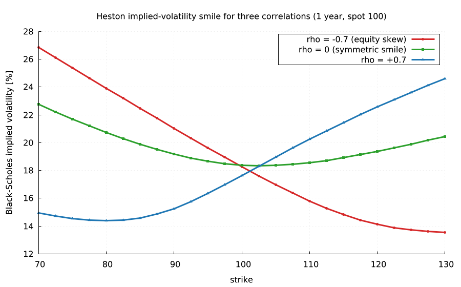 |
| --- | --- |
| Gamma: the at-the-money spike that sharpens toward expiry.<br>`lmctl autorun https://raw.githubusercontent.com/lmctl-ai/lmfinance/main/examples/gallery/gamma_heatmap.lms` | Heston implied-volatility smile for three correlations.<br>`lmctl autorun https://raw.githubusercontent.com/lmctl-ai/lmfinance/main/examples/gallery/vol_smile.lms` |

| 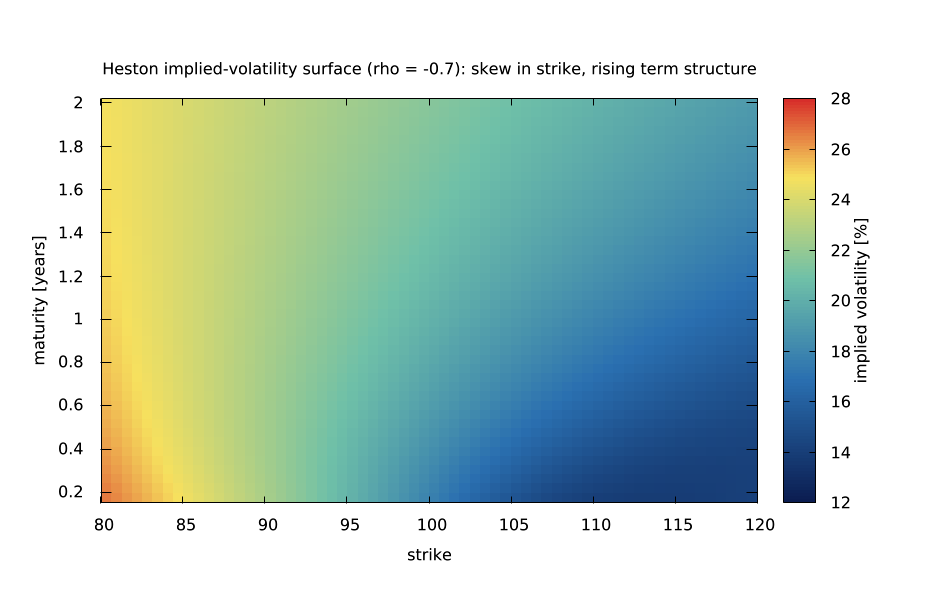 | |
| --- | --- |
| Heston implied-volatility surface: skew and term structure.<br>`lmctl autorun https://raw.githubusercontent.com/lmctl-ai/lmfinance/main/examples/gallery/vol_surface.lms` | |

### Rates and bonds

|  | 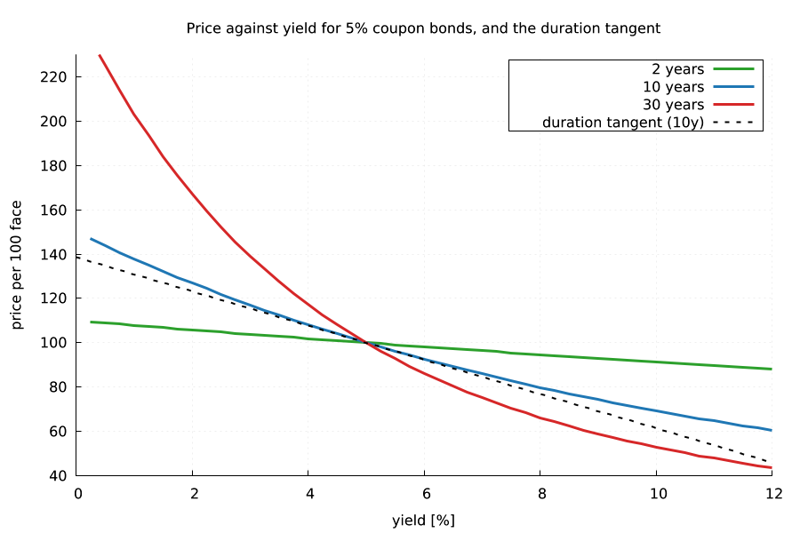 |
| --- | --- |
| A bootstrapped curve: zero and forward rates.<br>`lmctl autorun https://raw.githubusercontent.com/lmctl-ai/lmfinance/main/examples/gallery/yield_curve.lms` | Bond price against yield, with the duration tangent.<br>`lmctl autorun https://raw.githubusercontent.com/lmctl-ai/lmfinance/main/examples/gallery/bond_convexity.lms` |

| 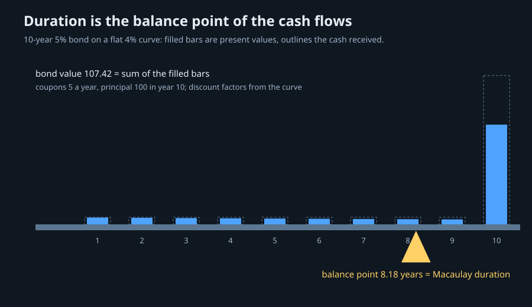 | 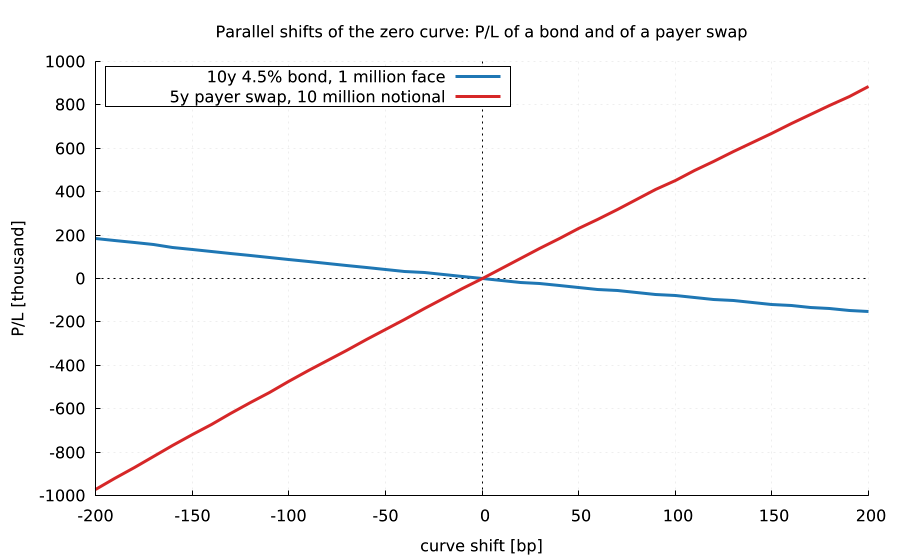 |
| --- | --- |
| Duration is the balance point of the discounted cash flows (lmdraw).<br>`lmctl autorun https://raw.githubusercontent.com/lmctl-ai/lmfinance/main/examples/gallery/bond_balance.lms` | Bond and swap P/L under parallel curve shifts.<br>`lmctl autorun https://raw.githubusercontent.com/lmctl-ai/lmfinance/main/examples/gallery/rate_scenarios.lms` |

| 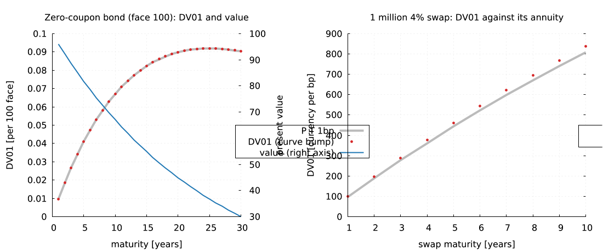 | |
| --- | --- |
| Where the rate risk sits: DV01 of zero bonds and swaps.<br>`lmctl autorun https://raw.githubusercontent.com/lmctl-ai/lmfinance/main/examples/gallery/dv01_ladder.lms` | |

### Numerics and risk

| 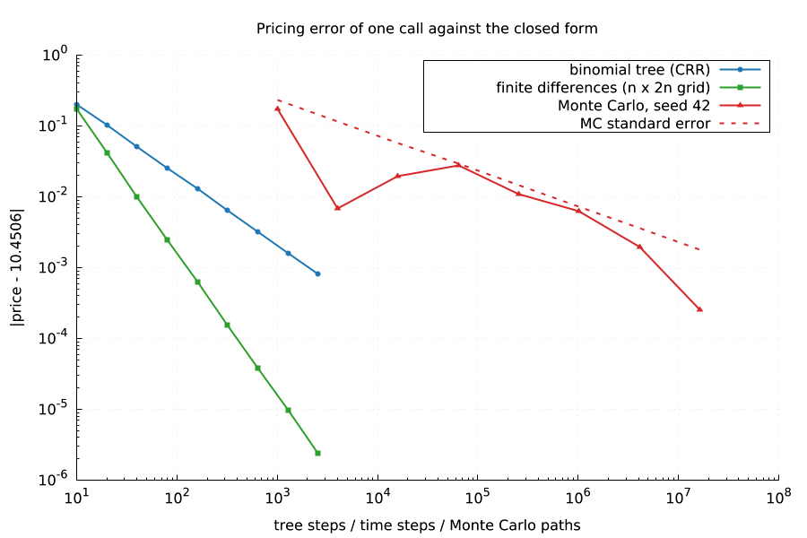 | 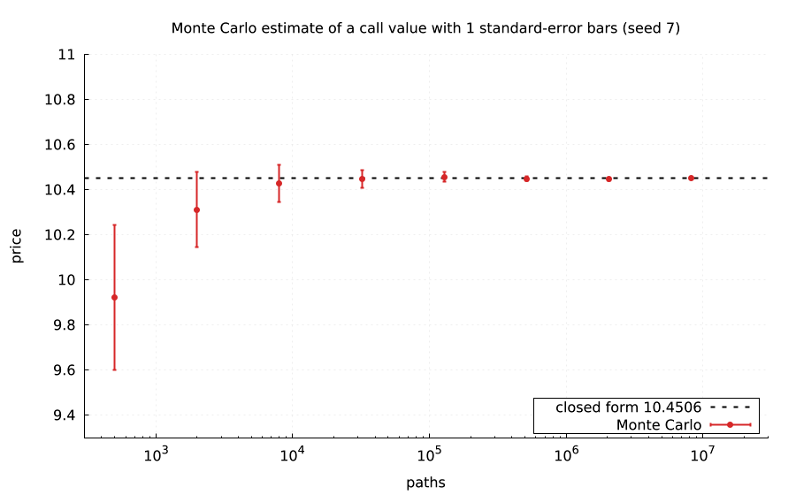 |
| --- | --- |
| Tree, finite-difference and Monte Carlo errors against the closed form.<br>`lmctl autorun https://raw.githubusercontent.com/lmctl-ai/lmfinance/main/examples/gallery/engine_convergence.lms` | Seeded Monte Carlo inside its error bars.<br>`lmctl autorun https://raw.githubusercontent.com/lmctl-ai/lmfinance/main/examples/gallery/mc_convergence.lms` |

| 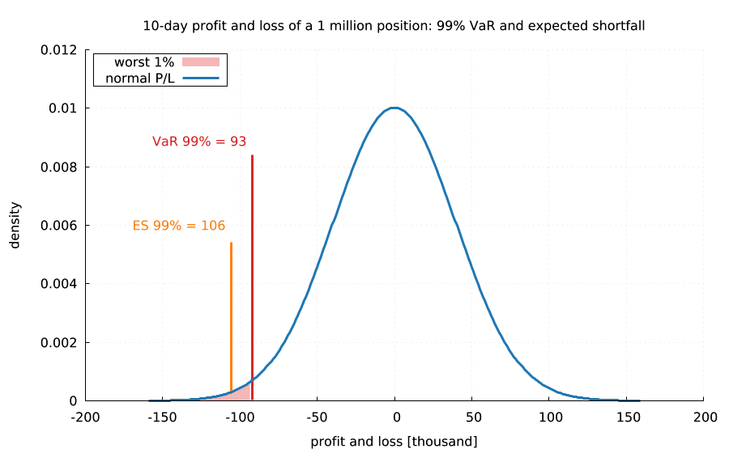 | |
| --- | --- |
| 99% VaR and expected shortfall of a position.<br>`lmctl autorun https://raw.githubusercontent.com/lmctl-ai/lmfinance/main/examples/gallery/var_tail.lms` | |

Each command runs the example from any empty directory: lmfinance computes, [lmplot](https://github.com/lmctl-ai/lmplot) or [lmdraw](https://github.com/lmctl-ai/lmdraw) draws, and the picture lands in `images/`. `examples/render-all.sh` regenerates `docs/images/` from a checkout.

**Quick start:** `npm i -g @lmctl-ai/lmctl`, then paste any `lmctl autorun` line above.

It is a scripting host,
not a command-line tool: write an [lmscript](https://lmctl.com/tools/lmscript/skill.html) `_dsl_`
block, compile it, run it with `lmfinance --dsl`. No Python, no Boost libraries, no shared libraries.

```
# bs.lms: Black-Scholes call S=100 K=100 r=5% vol=20% T=1 is worth 10.4506
p = _dsl_ cli="lmfinance" install="github:lmctl-ai/lmfinance@latest";
let m = model.black_scholes(100.0, 0.05, 0.0, 0.2);
let call = instrument.european_call(100.0, 1.0);
let r = pricing.price(call, m, pricing.analytic());
lmf.print("price " + str(r.price()) + " delta " + str(r.delta()));
lmf.assert_close(r.price(), 10.4506, 0.00005);
end _dsl_
savedsl(p, "bs.dslb");
system ${dsl_cli(p)} --dsl bs.dslb;
```

`lmscript bs.lms` finds `lmfinance` on `PATH` or downloads the release binary for your platform on
first use, compiles against the schema built into it, and runs the program.

## What it does

Six namespaces, each a context object of the schema; objects are built by chained methods
(the DSL has no lists or closures). Rates are decimals (`0.05`), maturities are years, dates are
`YYYY-MM-DD` strings. The evaluation date defaults to 2024-01-02 (never the system clock) and is set
with `market.set_date`.

| namespace | functions |
| --- | --- |
| `market` | `set_date` `date` `flat_curve(r)` `zero_curve()` `bootstrap_curve()` → `CurveBuilder` `.zero(years, rate)` `.deposit("3M", rate)` `.swap("5Y", rate)` `.build()` → `Curve` `.discount .zero .forward .bumped .save_csv` |
| `instrument` | `european_call/put(K, T)` `american_call/put(K, T)` → `Option`; `bond(face, coupon, years, freq)` `zero_bond(face, years)` → `Bond`; `swap(notional, fixed_rate, years)` → `Swap` `.receiver .payer .spread` |
| `model` | `black_scholes(S, r, q, vol)` `heston(S, r, q, v0, kappa, theta, sigma, rho)` → `Model` `.param .with_spot .with_rate .with_vol` |
| `pricing` | engines `analytic()` `binomial(n)` `binomial_tree("crr"\|"jr"\|"tian"\|"lr", n)` `finite_diff(tsteps, grid)` `monte_carlo(paths, seed)` `baw()`; `price(option, model, engine)` → `Result` `.price .stderr .delta .gamma .vega .theta .rho`; bonds: `bond_clean_price bond_npv bond_accrued bond_price_from_yield bond_yield bond_duration bond_macaulay_duration bond_convexity`; swaps: `swap_npv swap_par_rate swap_annuity` |
| `risk` | bumped `delta gamma vega rho theta` for any engine; `bond_dv01` `swap_dv01`; `var_normal` `es_normal`; `save_profile` (price, delta, gamma over a spot range, CSV) |
| `calibration` | `implied_vol(option, model, engine, price)`; `heston(S, r, q)` → `HestonFit` `.quote(K, T, vol)` `.guess(...)` `.fit()` → `Model` `.error()` |
| `lmf` | `assert_close` `check` `print` `save_text` `version` |

Conventions and details: [durable-memory/03-schema-v0.md](durable-memory/03-schema-v0.md).

Combine it with other hosts in one script: [examples/gallery/](examples/gallery) bootstraps curves, prices and profiles options with lmfinance and draws them with [lmplot](https://github.com/lmctl-ai/lmplot)
(two `_dsl_` blocks, two hosts).

## Examples

| Program | Shows | Run it |
| --- | --- | --- |
| [option_pricing.lms](examples/option_pricing.lms) | one call and one American put through every engine, binomial error against the closed form | `lmctl autorun https://raw.githubusercontent.com/lmctl-ai/lmfinance/main/examples/option_pricing.lms` |
| [bond_curve.lms](examples/bond_curve.lms) | curve bootstrapped from deposits and swaps reprices its inputs; bond price, yield, duration, DV01 | `lmctl autorun https://raw.githubusercontent.com/lmctl-ai/lmfinance/main/examples/bond_curve.lms` |
| [greeks.lms](examples/greeks.lms) | analytic, tree and Monte Carlo Greeks agree | `lmctl autorun https://raw.githubusercontent.com/lmctl-ai/lmfinance/main/examples/greeks.lms` |
| [heston_smile.lms](examples/heston_smile.lms) | a Heston smile and a calibration that recovers its five parameters | `lmctl autorun https://raw.githubusercontent.com/lmctl-ai/lmfinance/main/examples/heston_smile.lms` |
| [portfolio_risk.lms](examples/portfolio_risk.lms) | DV01s, normal VaR and expected shortfall of a small book | `lmctl autorun https://raw.githubusercontent.com/lmctl-ai/lmfinance/main/examples/portfolio_risk.lms` |
| [gallery/option_decay.lms](examples/gallery/option_decay.lms) | Call value melting onto its payoff, animated | `lmctl autorun https://raw.githubusercontent.com/lmctl-ai/lmfinance/main/examples/gallery/option_decay.lms` |
| [gallery/yield_curve.lms](examples/gallery/yield_curve.lms) | Bootstrapped yield curve: zero and forward rates | `lmctl autorun https://raw.githubusercontent.com/lmctl-ai/lmfinance/main/examples/gallery/yield_curve.lms` |
| [gallery/option_greeks.lms](examples/gallery/option_greeks.lms) | Call price and delta against spot | `lmctl autorun https://raw.githubusercontent.com/lmctl-ai/lmfinance/main/examples/gallery/option_greeks.lms` |
| [gallery/american_put.lms](examples/gallery/american_put.lms) | American vs European put: early-exercise premium | `lmctl autorun https://raw.githubusercontent.com/lmctl-ai/lmfinance/main/examples/gallery/american_put.lms` |
| [gallery/bond_convexity.lms](examples/gallery/bond_convexity.lms) | Bond price against yield with the duration tangent | `lmctl autorun https://raw.githubusercontent.com/lmctl-ai/lmfinance/main/examples/gallery/bond_convexity.lms` |
| [gallery/rate_scenarios.lms](examples/gallery/rate_scenarios.lms) | Bond and swap P/L under parallel curve shifts | `lmctl autorun https://raw.githubusercontent.com/lmctl-ai/lmfinance/main/examples/gallery/rate_scenarios.lms` |
| [gallery/vol_smile.lms](examples/gallery/vol_smile.lms) | Heston implied-volatility smile for three correlations | `lmctl autorun https://raw.githubusercontent.com/lmctl-ai/lmfinance/main/examples/gallery/vol_smile.lms` |
| [gallery/engine_convergence.lms](examples/gallery/engine_convergence.lms) | Tree, finite-difference and Monte Carlo error | `lmctl autorun https://raw.githubusercontent.com/lmctl-ai/lmfinance/main/examples/gallery/engine_convergence.lms` |
| [gallery/mc_convergence.lms](examples/gallery/mc_convergence.lms) | Seeded Monte Carlo inside its error bars | `lmctl autorun https://raw.githubusercontent.com/lmctl-ai/lmfinance/main/examples/gallery/mc_convergence.lms` |
| [gallery/option_strategies.lms](examples/gallery/option_strategies.lms) | Straddle, bull spread and butterfly: value today against payoff; put-call parity asserted | `lmctl autorun https://raw.githubusercontent.com/lmctl-ai/lmfinance/main/examples/gallery/option_strategies.lms` |
| [gallery/gamma_heatmap.lms](examples/gallery/gamma_heatmap.lms) | Gamma over spot and time to expiry, checked against the Black-Scholes formula | `lmctl autorun https://raw.githubusercontent.com/lmctl-ai/lmfinance/main/examples/gallery/gamma_heatmap.lms` |
| [gallery/vol_surface.lms](examples/gallery/vol_surface.lms) | Heston implied-volatility surface: skew and term structure | `lmctl autorun https://raw.githubusercontent.com/lmctl-ai/lmfinance/main/examples/gallery/vol_surface.lms` |
| [gallery/bond_balance.lms](examples/gallery/bond_balance.lms) | Duration as the balance point of discounted cash flows (lmdraw) | `lmctl autorun https://raw.githubusercontent.com/lmctl-ai/lmfinance/main/examples/gallery/bond_balance.lms` |
| [gallery/dv01_ladder.lms](examples/gallery/dv01_ladder.lms) | DV01 of zero bonds and swaps against P T and the annuity | `lmctl autorun https://raw.githubusercontent.com/lmctl-ai/lmfinance/main/examples/gallery/dv01_ladder.lms` |
| [gallery/var_tail.lms](examples/gallery/var_tail.lms) | 99% VaR and expected shortfall of a position | `lmctl autorun https://raw.githubusercontent.com/lmctl-ai/lmfinance/main/examples/gallery/var_tail.lms` |

`tests/` holds the checks against textbook values (Black-Scholes 10.4506 and 5.5735, Hull's
example, the American put 6.0903, bond annuity formulas, put-call parity, Heston → Black-Scholes
limit, bootstrap round trips).

## Build

C++17 compiler, CMake 3.24, git, curl; nothing else.

```sh
scripts/sync-deps.sh            # QuantLib at the commit and Boost headers at the sha256 in deps.lock
cmake -S . -B build && cmake --build build     # Release, -O1 for QuantLib, about 3.5 minutes on 4 cores
./test.sh                       # needs lmscript on PATH
```

Linux builds are fully static; macOS links only system libraries; Windows links the MinGW runtime
statically. `lmfinance --notices` prints the license texts of everything inside.

## Resource limits

A program may use at most 4096 MiB in total (curves, objects, QuantLib engines and Monte Carlo samples,
everything the host keeps); beyond that it stops with a run error (exit 3) naming the limit, instead
of exhausting the machine. Set `LMFINANCE_MAX_MEMORY_MB` to change it, e.g.
`LMFINANCE_MAX_MEMORY_MB=16384 lmscript big.lms`.

## License

MIT ([LICENSE](LICENSE)). QuantLib is a modified BSD license and Boost (headers only) is BSL-1.0;
see [THIRD_PARTY_NOTICES](THIRD_PARTY_NOTICES).
